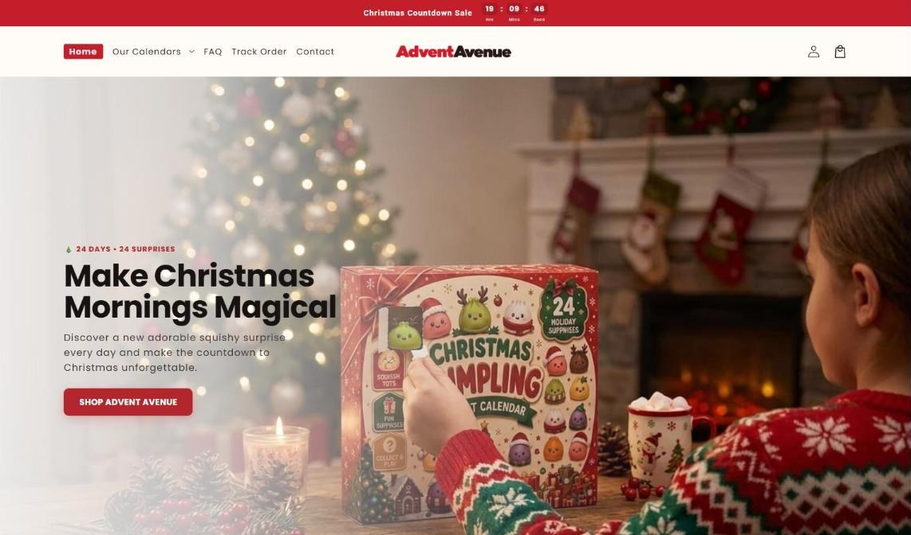
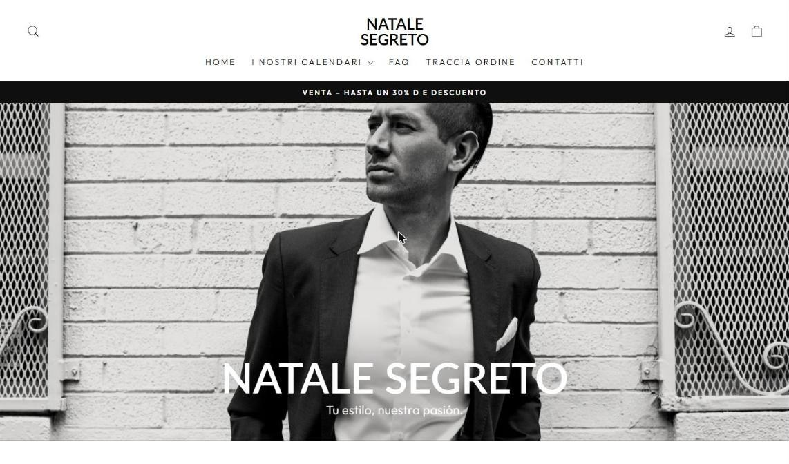
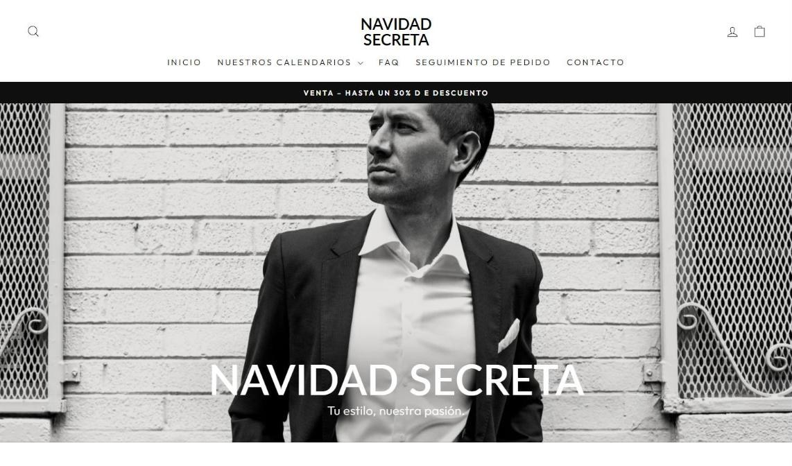
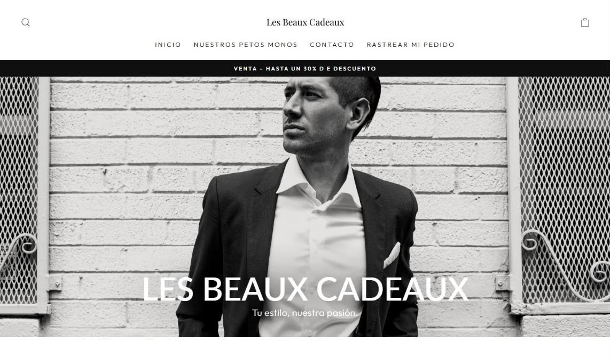
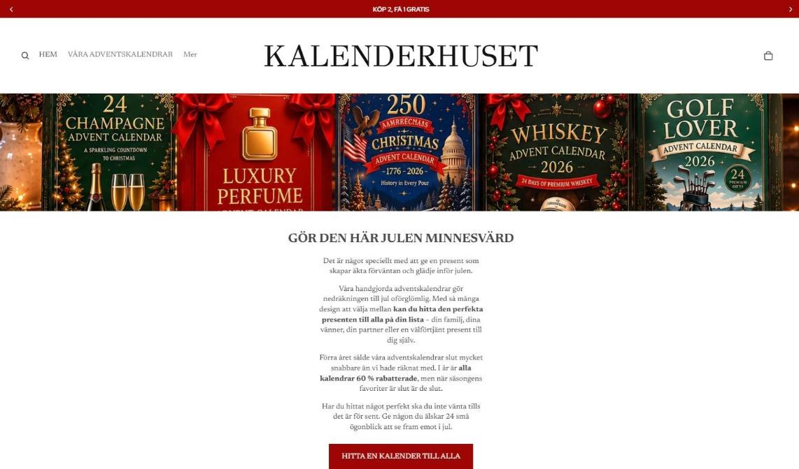
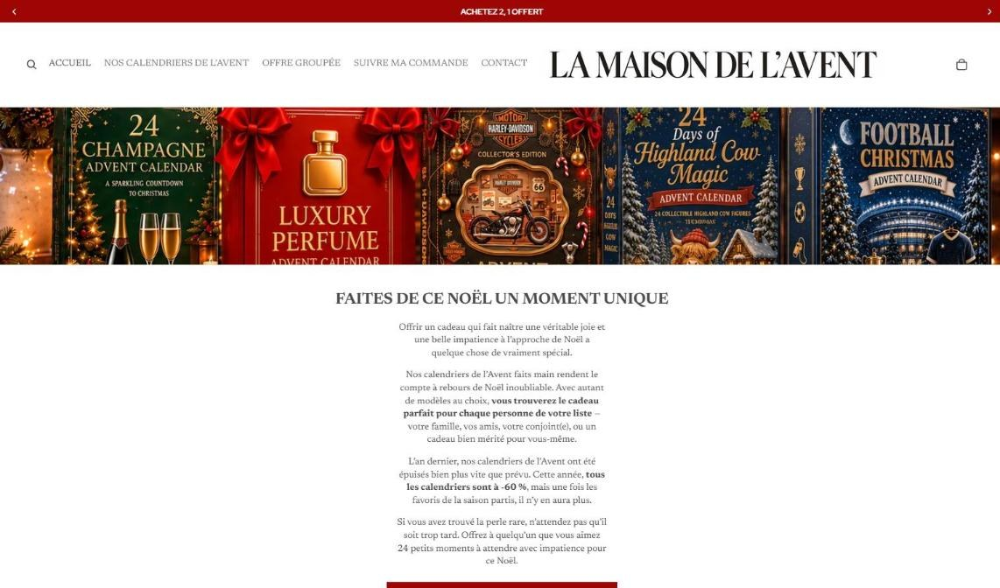
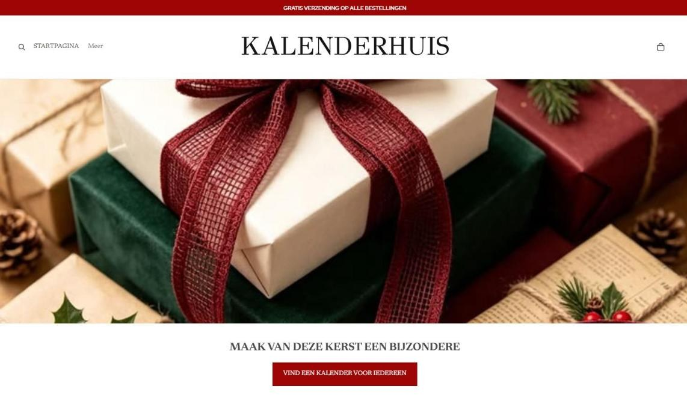
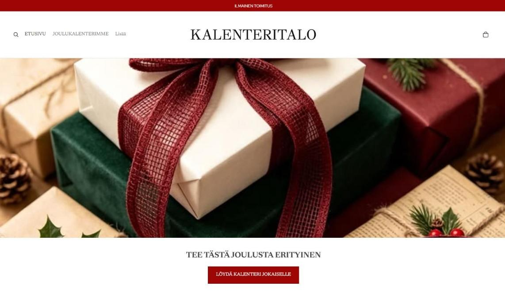
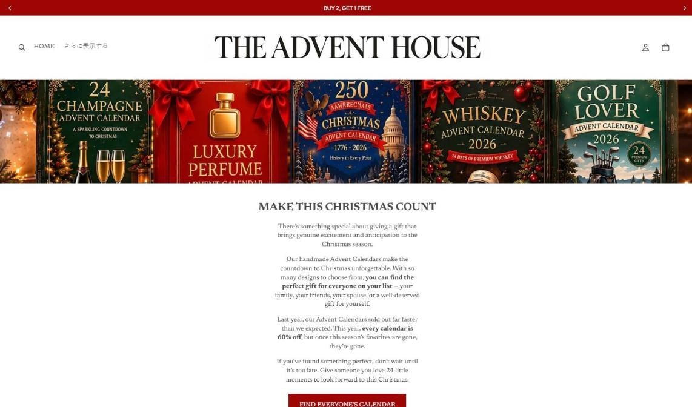
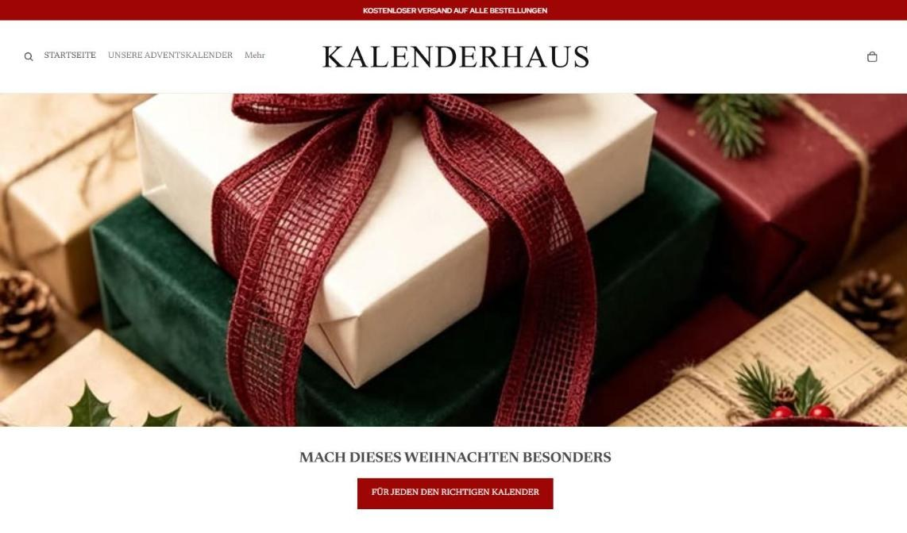

# Shopify Multi-Market Rollout

One advent-calendar store built once, then cloned and localized for 12 markets in 9 languages — translated navigation, copy, announcement bars and checkout flow.

| Live storefronts | Languages | Shared build |
|---|---|---|
| 12 | 9 | 1 |

| Store | Language | Screenshot |
|---|---|---|
| [Advent Avenue](https://shopadventavenue.com) | English |  |
| [Natale Segreto](https://natalesegreto.com) | Italian |  |
| [Navidad Secreta](https://navidadsecreta.com) | Spanish |  |
| [Beaux Cadeaux](https://lesbeauxcadeaux.com) | French |  |
| [Kalenderhuset](https://kalenderhuset.com) | Swedish |  |
| [La Maison de l’Avent](https://maison-avent.com) | French |  |
| [La Maison des Calendriers](https://lamaisondescalendriers.com) | French |  |
| [Kalenderhuis](https://kalenderhuis.com) | Dutch |  |
| [Kalenteritalo](https://kalenteritalo.com) | Finnish |  |
| [カレンダーハウス](https://thecalendarhouse.com) | Japanese |  |
| [Dom Kalendarzy](https://domkalendarzy.com) | Polish |  |
| [Kalenderhaus](https://daskalenderhaus.com) | German |  |
